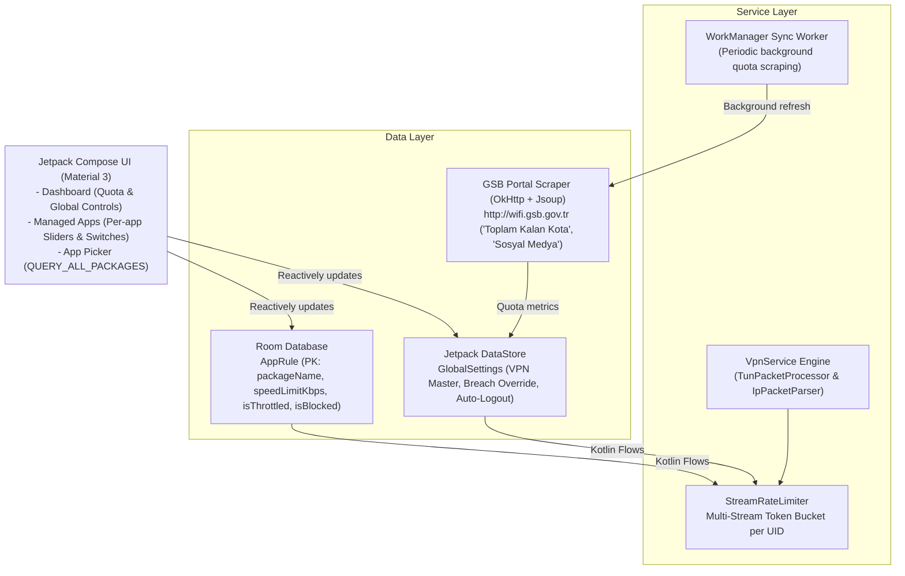

# GSB Wi-Fi Traffic Shaper & Dynamic Bandwidth Manager

A modern, modular Android application built with **Kotlin** and **Jetpack Compose (Material 3)**. The application connects to and monitors GSB Wi-Fi captive portals (`http://wifi.gsb.gov.tr`), computes daily budgets, and provides multi-stream, per-application bandwidth rate limiting and firewall control via an Android local `VpnService` engine.

---

## Architecture Overview



---

## Key Features

1. **Multi-Stream Token Bucket Bandwidth Shaper (`VpnService`)**:
   - High-throughput IP packet parser extracting IPv4/IPv6 headers and TCP/UDP ports.
   - UID resolution via `ConnectivityManager.getConnectionOwnerUid` with high-performance LRU socket tuple caching.
   - Distinct token buckets maintained per UID/package:
     - Example: App A (YouTube) capped at 1.5 Mbps (~187.5 KB/s).
     - Example: App B (Instagram) capped at 500 Kbps (~62.5 KB/s).
     - Unmanaged apps operate at wire speed unless a global breach override is active.
   - Zero-restart dynamic engine: UI slider and switch changes flow reactively to the running TUN packet loop via Kotlin Flows.

2. **GSB Captive Portal Scraper & Quota Engine**:
   - Direct HTTP scraping (`http://wifi.gsb.gov.tr`) using OkHttp and Jsoup.
   - Extracts "Toplam Kalan Kota" (Monthly total remaining) and "Sosyal Medya Kalan Kota".
   - Automatically computes dynamic daily budget:
     $$\text{Daily Budget (MB)} = \frac{\text{Remaining Monthly MB}}{\text{Remaining Days in Current Month}}$$
   - Tracks daily consumed bytes and displays dynamic color-coded progress.

3. **Global Override Engine**:
   - **Global Speed Limit on Breach**: When today's quota reaches 100%, device traffic is dynamically throttled to a configurable emergency speed cap (e.g., 128 Kbps).
   - **Auto-Logout on Breach**: Dispatches an HTTP logout request to `http://wifi.gsb.gov.tr/logout` automatically to prevent unexpected quota overages.
   - **Demo Mode**: Built-in simulator for testing quota indicators and rate limiting outside university dormitories.

4. **Dynamic Package Management & App Picker**:
   - Configured with `QUERY_ALL_PACKAGES` permission and UI rationale dialogue.
   - Full device app picker supporting real-time search and system-app filtering.
   - Per-app controls:
     - Bandwidth throttling toggle.
     - Custom speed slider (64 Kbps to 50 Mbps with quick presets).
     - Complete internet firewall block switch.
     - Delete rule button.

---

## Project Structure

```
GSBTrafficShaper/
├── app/
│   ├── build.gradle.kts
│   ├── proguard-rules.pro
│   └── src/main/
│       ├── AndroidManifest.xml
│       ├── java/com/gsb/trafficshaper/
│       │   ├── GsbApplication.kt
│       │   ├── data/
│       │   │   ├── local/
│       │   │   │   ├── AppDatabase.kt
│       │   │   │   ├── AppRule.kt
│       │   │   │   ├── AppRuleDao.kt
│       │   │   │   └── PreferencesManager.kt
│       │   │   ├── model/
│       │   │   │   ├── GlobalSettings.kt
│       │   │   │   ├── GsbQuotaInfo.kt
│       │   │   │   └── InstalledAppInfo.kt
│       │   │   ├── remote/
│       │   │   │   └── GsbPortalScraper.kt
│       │   │   └── repository/
│       │   │       ├── AppRuleRepository.kt
│       │   │       ├── InstalledAppsRepository.kt
│       │   │       └── QuotaRepository.kt
│       │   ├── di/
│       │   │   └── AppModule.kt
│       │   ├── service/
│       │   │   ├── vpn/
│       │   │   │   ├── IpPacketParser.kt
│       │   │   │   ├── StreamRateLimiter.kt
│       │   │   │   ├── TokenBucket.kt
│       │   │   │   ├── TrafficShaperVpnService.kt
│       │   │   │   ├── TunPacketProcessor.kt
│       │   │   │   └── UidResolver.kt
│       │   │   └── worker/
│       │   │       └── GsbQuotaWorker.kt
│       │   └── ui/
│       │       ├── MainActivity.kt
│       │       ├── apps/
│       │       │   ├── AppPickerSheet.kt
│       │       │   ├── ManagedAppsScreen.kt
│       │       │   └── ManagedAppsViewModel.kt
│       │       ├── common/
│       │       │   └── Components.kt
│       │       ├── dashboard/
│       │       │   ├── DashboardScreen.kt
│       │       │   └── DashboardViewModel.kt
│       │       ├── navigation/
│       │       │   ├── AppNavigation.kt
│       │       │   └── Screen.kt
│       │       └── theme/
│       │           ├── Color.kt
│       │           ├── Theme.kt
│       │           └── Type.kt
│       └── res/
│           ├── drawable/
│           ├── mipmap-anydpi-v26/
│           └── values/
├── gradle/
│   ├── libs.versions.toml
│   └── wrapper/
├── build.gradle.kts
├── gradle.properties
└── settings.gradle.kts
```

---

## How to Build & Run

1. Open **Android Studio** (Koala, Ladybug, or newer).
2. Select **Open** and choose the directory `C:\Users\Acer\.gemini\antigravity\scratch\GSBTrafficShaper`.
3. Allow Gradle to synchronize dependencies.
4. Run on an Android device or emulator running **Android 8.0 (API 26) through Android 15 (API 35)**.
5. On the first VPN activation, accept the standard system Android VPN dialog (`VpnService.prepare`).
